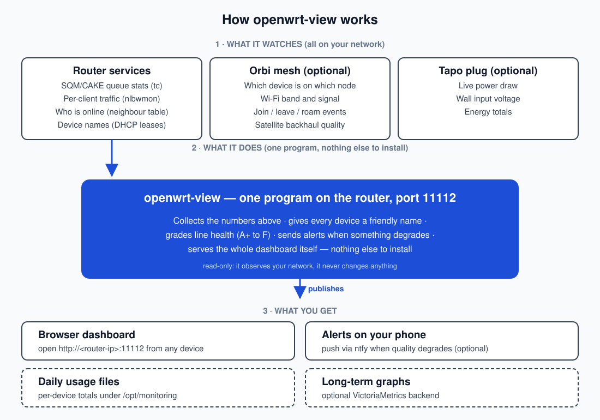

# openwrt-view

A single-binary monitoring panel for OpenWrt routers: real-time CAKE/SQM queue
statistics, WAN health, bufferbloat grading, per-client traffic accounting,
mesh Wi-Fi client tracking, smart-plug power monitoring, health verdicts and
push alerts — no runtime dependencies, read-only observation, it never changes
the network configuration.

## Architecture



1. **What it watches** — the router's own services: `tc`/`sch_cake` queue
   stats (100 ms), `nlbwmon` + `ip neigh` per-client accounting (30 s),
   DHCP/hosts name sources, WAN/system checks, and optionally a Netgear Orbi
   mesh (which device is on which node, band, signal, roams) and a Tapo
   smart plug.
2. **What it does** — one Go program on the router collects all of it, gives
   every device a friendly name, grades line health (A+ to F), raises events
   and alerts when something degrades, and serves the dashboard itself on
   port 11112. It is strictly read-only.
3. **What you get** — the browser dashboard (`http://<router-ip>:11112`),
   JSONL usage files under `/opt/monitoring`, optional VictoriaMetrics
   long-term history, and optional ntfy push alerts.

## Requirements

- OpenWrt (procd) or any Linux with systemd
- `tc` (iproute2) and the `sch_cake` module (`kmod-sched-cake` on OpenWrt);
  install SQM (`luci-app-sqm`) if you want meaningful queue statistics
- `nlbwmon` for per-client traffic accounting
- Go 1.26+ only if you build from source

## Installation

### Step 1 — Prepare the router

SSH into the router as root (OpenWrt ships dropbear):

```sh
ssh root@<router-ip>     # fresh OpenWrt has no password — set one with `passwd`
```

Install the dependencies (opkg; on apk-based OpenWrt 24.10+ use `apk add`):

```sh
opkg update
opkg install ip-tc nlbwmon kmod-sched-cake
```

Optional but recommended — passwordless SSH so scripts and your PC can log in
without typing the password. From your PC, copy your public key to the router:

```sh
ssh-copy-id root@<router-ip>
ssh root@<router-ip> true && echo "SSH OK"
```

`ssh-copy-id` appends your **public** key to `/etc/dropbear/authorized_keys`
on the router. Nothing is sent anywhere else; afterwards
`ssh root@<router-ip>` needs no password.

### Step 2 — Install openwrt-view

**Option A — install script (recommended).** Run on the router as root; it
detects the architecture (including MIPS endianness), downloads the matching
binary from GitHub Releases, installs `/usr/bin/openwrt-view`, writes the
procd init script and hotplug hook, and starts the service:

```sh
sh <(wget -qO- https://github.com/dinjojo/openwrt-view/releases/latest/download/install.sh) --port 11112
```

**Option B — build from source.** On any machine with Go 1.26+:

```sh
git clone https://github.com/dinjojo/openwrt-view && cd openwrt-view
CGO_ENABLED=0 GOOS=linux GOARCH=arm64 \
  go build -ldflags "-s -w -X main.Version=$(git describe --tags --always)" \
  -o openwrt-view ./cmd/openwrt-view
scp -O openwrt-view root@<router-ip>:/usr/bin/          # -O: OpenWrt has no sftp-server
```

Then on the router run the same install script as above (it keeps your
existing binary if it is already in place).

(`GOARCH` values: `arm64` for NanoPi/RPi-class routers, `mipsle`/`mips` for
most MT7621-era hardware, `amd64` for x86 routers.)

### Step 3 — Verify

```sh
curl -s http://<router-ip>:11112/api/stats | head -c 200
```

Open `http://<router-ip>:11112` in a browser. The service is enabled at boot;
the hotplug hook restarts it when interfaces bounce.

## Configuration (all optional)

Integrations are configured via root-only KEY=VALUE files under
`/opt/monitoring`, so credentials never appear in `ps` or `/proc` cmdlines.
Restart the service after changing them.

**Orbi mesh** — `/opt/monitoring/orbi.conf` (mode 600):

```ini
ORBI_URL=http://192.168.1.100
ORBI_USER=admin
ORBI_PASS=***
# optional: per-client radio stats via the Orbi's SSH/telnet shell
ORBI_SSH_USER=root
ORBI_SSH_PASS=***
```

**Tapo plug** — `/opt/monitoring/tapo.conf` (mode 600):

```ini
TAPO_HOST=192.168.1.242
TAPO_USER=you@example.com
TAPO_PASS=***
```

**Push alerts** — add to either conf file:

```ini
ALERT_NTFY_URL=https://ntfy.sh/your-secret-topic
ALERT_NTFY_TOKEN=***
```

**VictoriaMetrics** — the service takes `-vm` (default
`http://127.0.0.1:8428`). An unreachable VM only disables long-term history;
everything else keeps working.

Apply with `/etc/init.d/openwrt-view restart`.

## Name your devices

The client table resolves names in this order:

1. DHCP lease hostname (including static lease names) — best
2. Static lease name from `/etc/config/dhcp`
3. `/etc/hosts` entry for the client's IP
4. MAC OUI vendor cache ("Samsung 2c00")
5. `device-xxxx` fallback (last MAC octets)

Wi-Fi modules often report the *module* vendor (Liteon, AzureWave, Realtek),
not the product brand — a static lease name fixes the display:

```sh
# on the router
uci add dhcp host
uci set dhcp.@host[-1].name='MiBox'
uci set dhcp.@host[-1].mac='AA:BB:CC:00:00:01'
uci set dhcp.@host[-1].ip='192.168.1.200'
uci commit dhcp && /etc/init.d/dnsmasq restart
```

Behaviour notes:

- Traffic attributed to the **router's own interface MACs** never appears as
  a client row (no phantom `device-xxxx` entry for the router itself).
- Online state: a device is online while the neighbour table lists it
  (`REACHABLE`/`DELAY`/`PROBE`/`STALE`) or it had traffic in the last 30 s
  poll. A device that goes silent can therefore show online for a short
  while; rows vanish from the table after 24 h offline.
- The Orbi device list is a 60 s cached snapshot: roams between router and
  satellite take a minute or two to show up.
- Event messages use names resolved from DHCP/static leases and the vendor
  cache, falling back to the Orbi's own labels.

## Updating and uninstall

```sh
# update (on the router)
sh <(wget -qO- https://github.com/dinjojo/openwrt-view/releases/latest/download/install.sh) --port 11112

# uninstall (keeps /opt/monitoring data)
sh uninstall.sh
```

Usage files, events history and the VictoriaMetrics data survive upgrades.

## Development

```sh
go build ./... && go test ./... && go vet ./...
```

Pushes to `main` are auto-tagged (patch bump) and cross-compiled for linux,
Windows and FreeBSD by [`.github/workflows/build.yml`](.github/workflows/build.yml).
See [DESIGN.md](DESIGN.md) for internals and [PRODUCT.md](PRODUCT.md) for the
product philosophy.

## License

[MIT](LICENSE)
